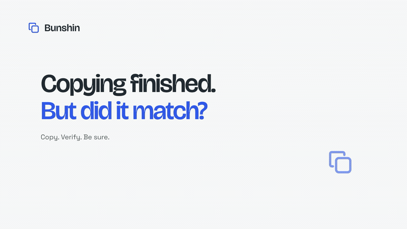
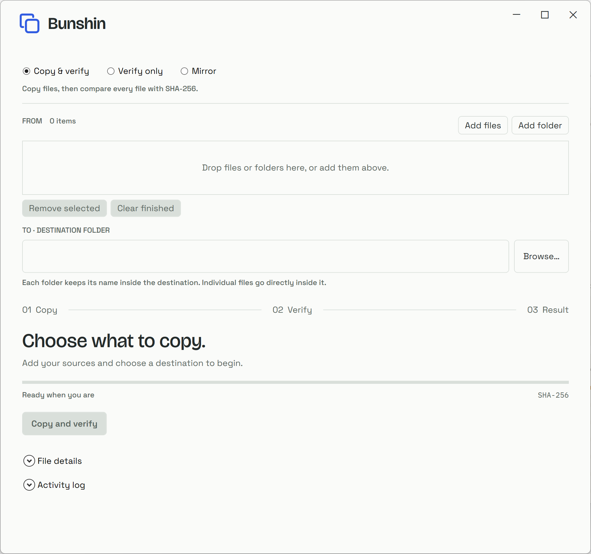
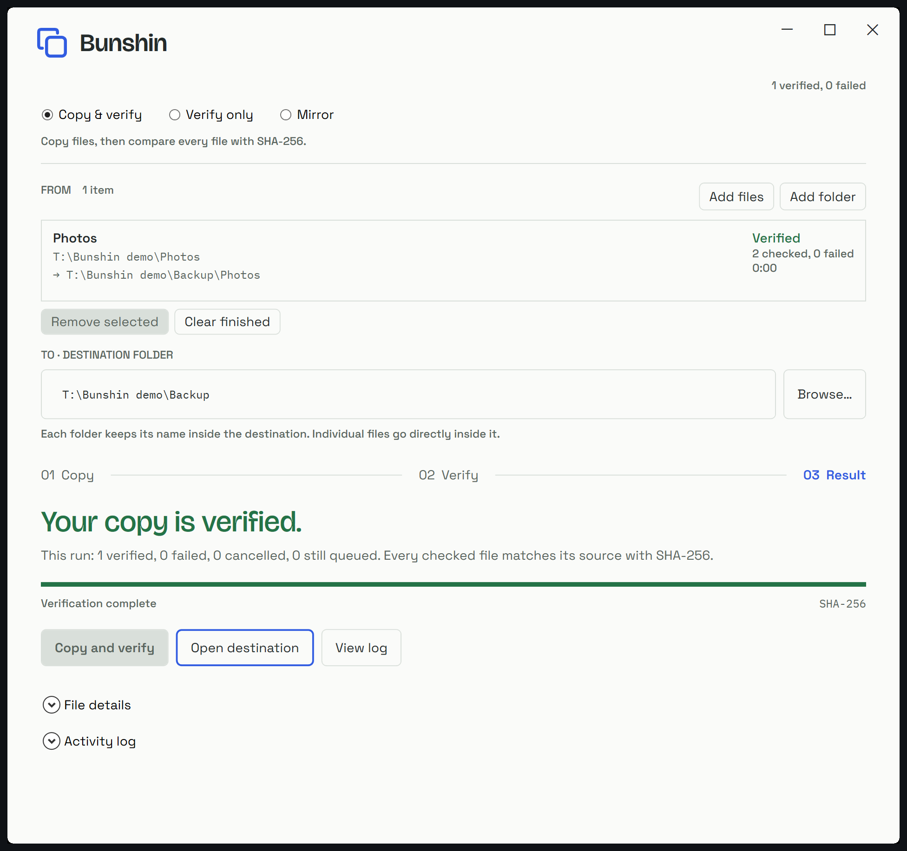
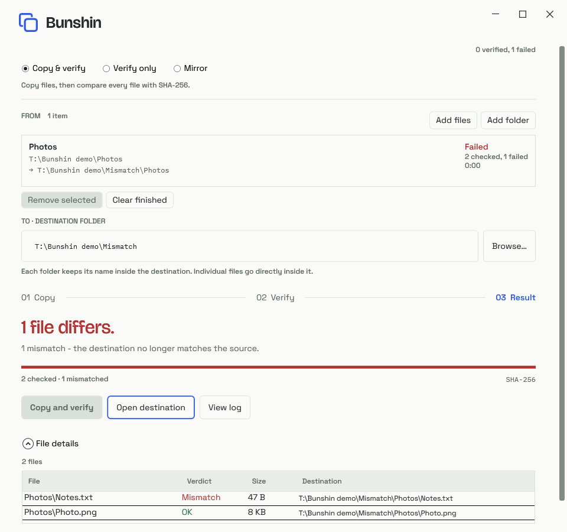

<p align="center">
  
</p>

<h1 align="center">Bunshin</h1>
<p align="center"><strong>Copy. Verify. Be sure.</strong><br>A Windows file-copy app that checks whether your copy matches the original.</p>

Copying has finished. But did everything arrive intact? Bunshin copies your files,
checks their contents with SHA-256, and gives you a clear result. Use it when
moving photos, handing off a project, or checking an existing copy.

[Get started](#get-started) · [Choose a mode](#choose-a-mode) · [Command line](#prefer-the-command-line) · [Full guide](docs/USAGE.md)

## See it in 25 seconds

[](demo/brag-output/brag.mp4)

*Choose your files → review their destination → see the verification result.*
Click the animation for the [MP4 with sound](demo/brag-output/brag.mp4).
This edited tour uses actual Bunshin screenshots; the timing does not represent transfer speed.

## Get started

**Windows x64 · portable · no administrator access required**

1. Download the portable ZIP from [GitHub Actions](https://github.com/lsj5031/bunshin/actions/workflows/ci.yml):
   open a successful **Verify Bunshin** run and download **bunshin-win-x64-preview**
   under **Artifacts**. You must be signed in and have access to this repository.
2. Extract the artifact, then extract the `bunshin-…-win-x64.zip` inside it.
3. Open **Bunshin.exe**. The portable build includes its runtime.
4. Add files or folders, choose a destination, and review the target shown for each source.
5. Select **Copy and verify**, then wait for the final verdict.

> **Preview software:** the current version is **0.1.0-preview.3** and is unsigned.
> Windows may warn before opening it. Compare the ZIP's SHA-256 with the included
> `.sha256` file. Local disk workflows have been tested; network shares need broader testing.



## Know what arrived

**Your copy is verified.** Bunshin checks file contents, rather than relying only
on names, sizes or timestamps. Expand **File details** to see each file's verdict,
or open **Activity log** for a record of the run.



**A mismatch stays visible.** If a file differs, Bunshin tells you which one.
It does not silently repair mismatches. Remove the incorrect destination file
and copy again to repair it.

<details>
<summary>See a mismatch result</summary>



</details>

## Choose a mode

| Mode | Use it when… | What happens |
| --- | --- | --- |
| **Copy and verify** | You want a new copy you can check. | Copies into the destination, then compares contents with SHA-256. Existing matching-size/timestamp files may skip copying but still get verified. |
| **Verify only** | You already have a copy. | Compares source and destination without copying or creating a destination. |
| **Mirror and verify** | A destination is dedicated to one source folder. | Copies and verifies, and **deletes destination extras** after confirmation. Folder sources only. |

A source folder named `Photos` lands at `Backup\Photos`, rather than merging
directly into `Backup`. Review the resolved path before starting.

**Stop safely** requests cancellation and waits for cleanup. Completed files are
kept, but a stopped run is not reported as fully verified. Mirror and busy-close
confirmations default to **Cancel**.

## Prefer the command line?

The included CLI uses Windows' robocopy. Add `-Verify` to check contents after copying:

```powershell
.\bunshin.ps1 'D:\Photos' 'E:\Backup' -Verify
.\bunshin.ps1 'D:\Photos' 'E:\Backup' -VerifyOnly
```

You can also add **Bunshin** to Explorer's **Send to** menu with
`Install-SendTo.ps1`. This optional shortcut runs the CLI with verification;
it does not replace Explorer's copy handler. Remove it with
`Install-SendTo.ps1 -Uninstall`.

[Full CLI options, installation help and troubleshooting →](docs/USAGE.md)

## A few boundaries

- Close apps that are changing the source. Verification checks bytes as they are
  read; Bunshin does not create a filesystem snapshot.
- Keep another backup of irreplaceable files. Bunshin does not provide version
  history, drive recovery or resumable transfers.
- Use separate source and destination trees. Overlap checks prevent common
  mistakes, but different drive/share aliases are not all resolved.
- Logs live in `%LOCALAPPDATA%\bunshin\logs`.

## Build from source

Requires Windows and the **.NET 10 SDK**:

```powershell
dotnet run --project gui\Bunshin.Gui.csproj
.\Publish-Portable.ps1
```

The second command creates the portable ZIP and checksum in `dist`.
See the [full development and verification guide](docs/USAGE.md#build-and-verify)
and [GUI acceptance report](qa/GUI-RESULTS.md) for checks and coverage limits.

## Contributing and license

Bug reports and focused improvements are welcome. Read [CONTRIBUTING.md](CONTRIBUTING.md)
for setup and testing, and [SECURITY.md](SECURITY.md) for private vulnerability reports.
Bunshin's original code is [MIT licensed](LICENSE); fonts and demo media retain
their [own licenses](THIRD_PARTY_NOTICES.md).
See the [open-source readiness checklist](docs/OPEN_SOURCE_READINESS.md) for
remaining public-release decisions and known limits.

## Credits

分身 (*bunshin*) evokes a double: a copy that matches its original.
Typography uses Bricolage Grotesque, Space Grotesk and IBM Plex Mono, inspired by
[Metic Studio](https://metic.studio/en); font licenses and provenance are in
[font provenance](https://github.com/lsj5031/bunshin/blob/main/gui/Fonts/PROVENANCE.md).

The tour was made with [Brag](https://github.com/latent-spaces/brag) and Hyperframes.
Music: Sascha Ende, [ende.app](https://ende.app), CC BY 4.0.
See [demo credits and reproduction steps](demo/brag-output/README.md).
